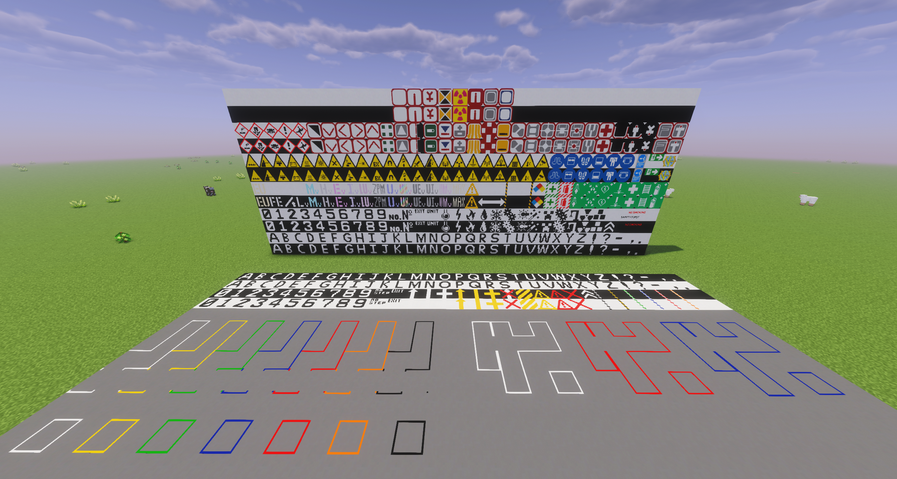
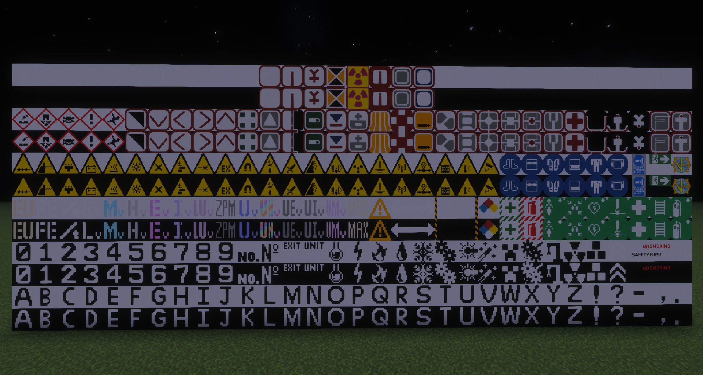
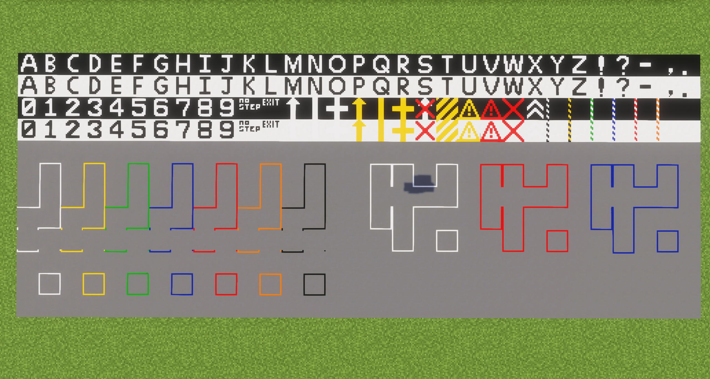

A 1.7.10 backport of the 1.12.2 backport for the very simple mod that adds various decorational markings.  

the 1.20.1 version -> https://github.com/Aminoglycoside148/modernmarkings_1.20.x  
the 1.12.2 version -> https://github.com/Aminoglycoside148/ModernMarkings_1.12.2_Rewrite_3  
 
Based on https://github.com/GTNewHorizons/ExampleMod1.7.10

### Screenshot

